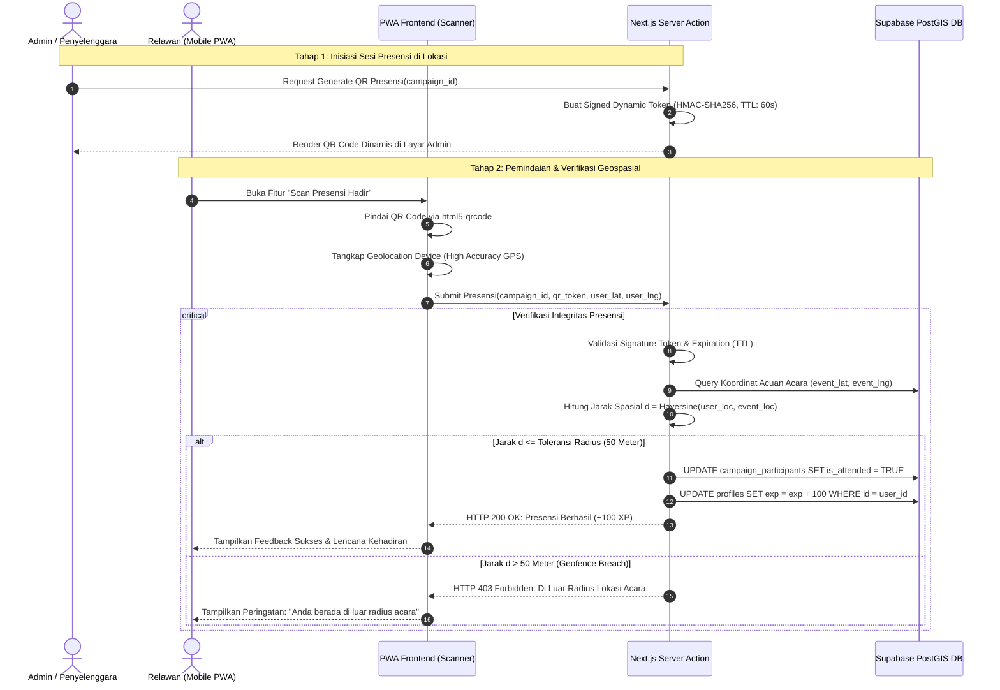
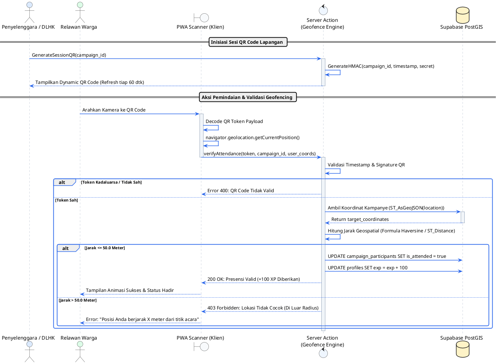
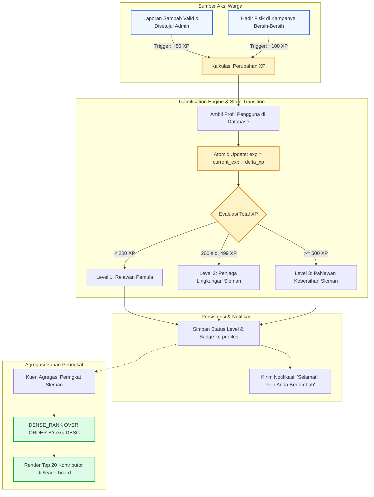
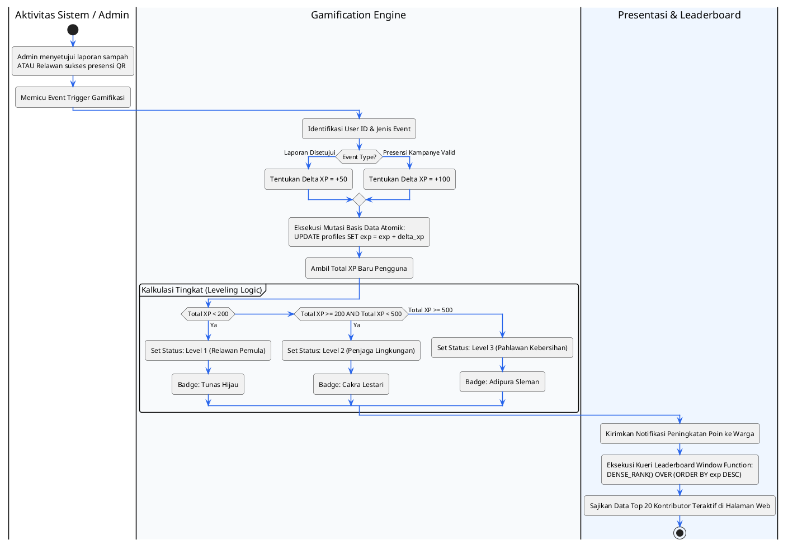
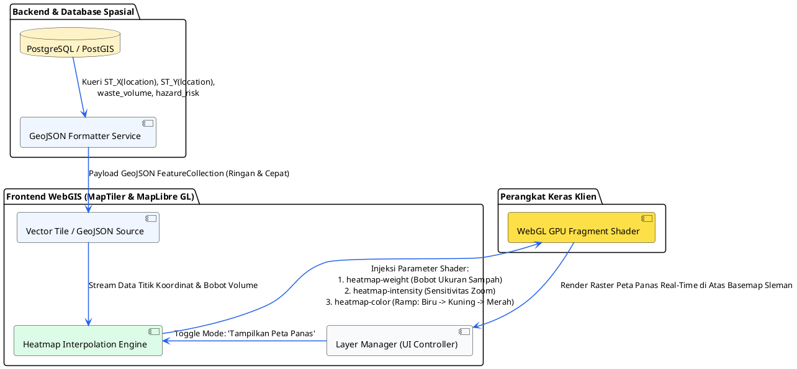

```mermaid
flowchart LR
    subgraph Data_Tier [1. Penyimpanan Data Spasial]
        DB[(Supabase PostGIS)] -->|Kueri SQL Geometri| Query["SELECT id, ST_X(location::geometry) as lng,
        ST_Y(location::geometry) as lat,
        waste_volume, hazard_risk
        FROM reports WHERE status != 'rejected'"]
    end

    subgraph Service_Tier [2. Serialisasi Standar Geospasial]
        Query --> Serializer[Server Action / API Route]
        Serializer -->|Konversi ke Standar RFC 7946| GeoJSON["FeatureCollection (GeoJSON):
        Geometry: Point [lng, lat]
        Properties: {weight: f(volume, risk)}"]
    end

    subgraph Client_WebGL_Pipeline [3. MapLibre GL Shader Pipeline]
        GeoJSON --> Source[Map Source: 'waste-reports']
        Source --> LayerConfig[Heatmap Layer Configuration]
        
        LayerConfig --> WCalc["heatmap-weight:
        1_pickup = 1.0
        1_truk_kecil = 2.0
        1_truk_besar = 3.5
        >1_truk_besar = 5.0"]
        
        LayerConfig --> ColorRamp["heatmap-color (Gradasi Suhu Panas):
        0.0 -> Transparan (Aman)
        0.2 -> Biru (Kerapatan Rendah)
        0.4 -> Hijau Neon (Sedang)
        0.6 -> Kuning (Waspada)
        1.0 -> Merah Tua (Hotspot Kritis)"]

        WCalc & ColorRamp --> GPU[WebGL Fragment Shader GPU Klien]
    end

    subgraph UI_Presentation [4. Tampilan Interaktif Peta]
        GPU --> RenderCanvas[Canvas Interaktif Peta Sleman]
        RenderCanvas --> LayerToggle{Toggle Antarmuka}
        LayerToggle -->|Mode Hotspot| ViewHeatmap[Visualisasi Peta Panas Konsentrasi]
        LayerToggle -->|Mode Cluster| ViewMarkers[Visualisasi Marker Titik Pin Laporan]
    end

    classDef db fill:#FEF3C7,stroke:#D97706,stroke-width:2px;
    classDef geo fill:#EFF6FF,stroke:#2563EB,stroke-width:2px;
    classDef webgl fill:#DCFCE7,stroke:#16A34A,stroke-width:2px;
    class DB,Query db;
    class Serializer,GeoJSON geo;
    class Source,LayerConfig,WCalc,ColorRamp,GPU webgl;
```

# Visualisasi Alur Sistem, Diagram, dan Logika Algoritma
## 3 Fitur Utama Tahap Proyek Profesional (PP) - WasteCare V2

Dokumen ini disusun untuk kebutuhan naskah laporan akademik (Bab 3 Metodologi & Bab 4 Implementasi), slide presentasi, serta panduan bimbingan dengan dosen pembimbing.

---

# FITUR 1: SISTEM PRESENSI KAMPANYE VIA QR CODE & GEOFENCING GPS

### 1. Identifikasi & Konteks Akademis
- **Nama Diagram / Alur**: Mekanisme Presensi Mandiri Relawan Menggunakan QR Code Dinamis dan Verifikasi Geofencing Spasial Anti-Spoofing.
- **Konteks Bab Skripsi**:
  - **Bab 3 (Metodologi)**: Perancangan subsistem verifikasi fisik partisipasi masyarakat (*Citizen Science Validation*) dan integritas data lapangan.
  - **Bab 4 (Implementasi)**: Modul Kampanye Lingkungan (`/admin/campaign` dan `/campaign/[id]`).
- **Aktor & Komponen**:

| Aktor / Komponen | Peran & Tanggung Jawab dalam Alur |
| :--- | :--- |
| **Penyelenggara / Admin DLHK** | Membuka layar sesi presensi di lokasi acara yang menghasilkan QR Code bertanda tangan kriptografis (*signed dynamic token*). |
| **Relawan (Mobile PWA)** | Memindai QR Code melalui kamera peramban PWA dan mengizinkan pembacaan koordinat GPS perangkat secara *real-time*. |
| **Next.js Server Action / API** | Memverifikasi masa berlaku token QR, identitas relawan, dan mengeksekusi kalkulasi jarak spasial (*Geofencing Engine*). |
| **Supabase PostGIS & DB** | Menyimpan koordinat acuan acara, memvalidasi relasi peserta (`campaign_participants`), dan memperbarui status `is_attended = true`. |

---

### 2. Visualisasi Flow 1: Format Mermaid



---

### 3. Visualisasi Flow 2: Format PlantUML



---

### 4. Logika Algoritma & Pseudocode

#### Spesifikasi I/O:
- **Input**: `campaign_id` (Integer), `qr_token` (String HMAC), `user_coords` (Latitude, Longitude dari sensor GPS perangkat).
- **Output**: `status` (Boolean: SUCCESS / REJECTED), `distance_meters` (Float), `awarded_exp` (Integer).

#### Pseudocode:
```text
ALGORITMA VerifyAttendanceWithGeofencing
INPUT: 
    campaign_id: Integer
    user_id: UUID
    qr_token: String
    user_lat: Float, user_lng: Float

OUTPUT: 
    Response(status_code: Integer, message: String)

KONSTANTA:
    MAX_RADIUS_METERS = 50.0
    EARTH_RADIUS_METERS = 6371000.0

DEKLARASI:
    campaign: Record
    token_valid: Boolean
    delta_lat, delta_lng: Float
    a, c, distance: Float

PROSES:
    // 1. Validasi Token QR Dinamis
    token_valid <- ValidateHMACToken(qr_token, campaign_id, MAX_AGE_SECONDS = 60)
    IF NOT token_valid THEN
        RETURN Response(401, "QR Code sudah kadaluarsa atau tidak valid")
    ENDIF

    // 2. Ambil Titik Acuan Lokasi Acara dari PostGIS
    campaign <- QUERY "SELECT location, status FROM campaigns WHERE id = campaign_id"
    IF campaign.status != 'ongoing' THEN
        RETURN Response(400, "Kegiatan kampanye belum dimulai atau telah berakhir")
    ENDIF

    // 3. Kalkulasi Jarak Geodesik (Haversine Formula)
    delta_lat <- Radians(user_lat - campaign.location.lat)
    delta_lng <- Radians(user_lng - campaign.location.lng)

    a <- Sin(delta_lat / 2)^2 + 
         Cos(Radians(campaign.location.lat)) * Cos(Radians(user_lat)) * Sin(delta_lng / 2)^2
    c <- 2 * Atan2(Sqrt(a), Sqrt(1 - a))
    distance <- EARTH_RADIUS_METERS * c

    // 4. Evaluasi Batas Ambang Geofence (Threshold)
    IF distance <= MAX_RADIUS_METERS THEN
        BEGIN TRANSACTION
            UPDATE campaign_participants 
            SET is_attended = TRUE, attended_at = NOW()
            WHERE campaign_id = campaign_id AND profile_id = user_id;

            UPDATE profiles 
            SET exp = exp + 100 
            WHERE id = user_id;
        COMMIT
        RETURN Response(200, "Presensi berhasil dicatat! Anda memperoleh 100 XP.")
    ELSE
        RETURN Response(403, "Gagal presensi: Anda terdeteksi berjarak " + Round(distance) + " meter dari lokasi.")
    ENDIF
END ALGORITMA
```

#### Analisis Kompleksitas & Boundary Conditions:
- **Kompleksitas**: Waktu O(1) (evaluasi trigonometri konstan) dan Ruang O(1).
- **Toleransi GPS Drift**: Nilai ambang batas ditetapkan pada **50 meter** untuk mengakomodasi deviasi akurasi sensor GPS smartphone di wilayah pemukiman berkepadatan tinggi tanpa mengorbankan integritas kehadiran fisik.

---

### 5. Bimbingan Talking Points (Panduan Presentasi ke Dosen)

- **Narasi Presentasi (Pitch 1 Menit)**:
  > "Bapak/Ibu Dosen, salah satu kendala terbesar dalam gerakan pelaporan lingkungan partisipatif adalah fenomena *slacktivism*—masyarakat mendaftar kampanye di web namun tidak hadir di lokasi pembersihan. Pada tahap PP ini, kami mengimplementasikan sistem **Presensi Fisik Mandiri berbasis QR Code dan Geofencing GPS**."
  >
  > "Penyelenggara di lapangan menampilkan QR Code terenkripsi dengan masa berlaku per menit, dan relawan memindainya langsung melalui aplikasi PWA WasteCare. Sistem kami menghitung jarak geodesik antara koordinat GPS ponsel relawan dengan titik acuan PostGIS lokasi acara. Presensi dan reward XP hanya disahkan jika relawan berada dalam radius sah maksimal 50 meter dari titik gotong royong."

- **Antisipasi Pertanyaan Kritis Dosen & Kunci Jawaban**:
  1. *Q: "Mengapa tidak cukup memakai scan QR Code saja tanpa perlu GPS geofencing?"*
     - **Jawaban**: "Jika hanya menggunakan QR Code statis, kode tersebut rentan difoto lalu dikirimkan via aplikasi pesan instan ke peserta lain yang berada di rumah untuk melakukan absensi palsu. Integrasi geofencing GPS memastikan syarat *Proof of Physical Presence* terpenuhi secara ganda."
  2. *Q: "Bagaimana jika relawan menggunakan aplikasi Fake GPS (mock location)?"*
     - **Jawaban**: "Pada peramban modern melalui Geolocation Web API, kami memanfaatkan parameter `enableHighAccuracy: true` dan memeriksa metadata `accuracy`. Selain itu, QR Code menggunakan token dinamis dengan TTL 60 detik (Time-based Token), sehingga menyulitkan relawan untuk memanipulasi koordinat secara tersinkronisasi di lapangan."

---
---

# FITUR 2: SISTEM GAMIFIKASI TERPADU & LEADERBOARD WARGA

### 1. Identifikasi & Konteks Akademis
- **Nama Diagram / Alur**: Mekanisme Penghargaan Pengalaman (XP Engine), Kenaikan Tingkat (Level Progression), dan Kalkulasi Papan Peringkat Spasial Warga.
- **Konteks Bab Skripsi**:
  - **Bab 3 (Metodologi)**: Kebutuhan Fungsional Gamifikasi (Tabel 3.1 Butir 5) untuk meningkatkan retensi pengguna (*User Engagement*).
  - **Bab 4 (Implementasi)**: Modul Profil Akun (`/akun`) dan Papan Peringkat (`/leaderboard`).
- **Aktor & Komponen**:

| Aktor / Komponen | Peran & Tanggung Jawab dalam Alur |
| :--- | :--- |
| **Warga Pelapor / Relawan** | Melakukan tindakan positif lingkungan (melaporkan sampah terverifikasi atau hadir di kampanye). |
| **XP Trigger Dispatcher** | Mendeteksi *event* validasi laporan dari admin atau presensi sukses dari modul kampanye. |
| **Gamification Engine** | Menghitung akumulasi XP, mengevaluasi perubahan lencana (*badge*), dan menetapkan tingkat akun. |
| **Leaderboard View (PostgreSQL)** | Menghitung peringkat warga se-Kabupaten Sleman menggunakan fungsi analitik jendela (*Window Function DENSE_RANK*). |

---

### 2. Visualisasi Flow 1: Format Mermaid



---

### 3. Visualisasi Flow 2: Format PlantUML



---

### 4. Logika Algoritma & Pseudocode

#### Spesifikasi I/O:
- **Input**: `user_id` (UUID), `event_type` (`'REPORT_APPROVED'` | `'CAMPAIGN_ATTENDED'`).
- **Output**: `current_level` (Integer), `badge_name` (String), `leaderboard_rank` (Integer).

#### Pseudocode:
```text
ALGORITMA AwardExperienceAndCalculateRank
INPUT: 
    target_user_id: UUID
    event_type: String

OUTPUT: 
    user_status: Record(exp: Integer, level: Integer, badge: String, rank: Integer)

PROSES:
    // 1. Pemetaan Poin Berdasarkan Jenis Aksi
    SWITCH event_type:
        CASE 'REPORT_APPROVED':
            earned_xp <- 50
        CASE 'CAMPAIGN_ATTENDED':
            earned_xp <- 100
        DEFAULT:
            earned_xp <- 0
    ENDSWITCH

    // 2. Pembaruan Nilai XP secara Atomik untuk Mencegah Race Condition
    BEGIN TRANSACTION
        UPDATE profiles
        SET exp = COALESCE(exp, 0) + earned_xp
        WHERE id = target_user_id
        RETURNING exp INTO updated_exp;

        // 3. Penentuan Level & Badge Berdasarkan Ambang Batas
        IF updated_exp < 200 THEN
            user_level <- 1
            user_badge <- "Relawan Pemula"
        ELSE IF updated_exp >= 200 AND updated_exp < 500 THEN
            user_level <- 2
            user_badge <- "Penjaga Lingkungan Sleman"
        ELSE
            user_level <- 3
            user_badge <- "Pahlawan Kebersihan Sleman"
        ENDIF

        // 4. Catat Log Riwayat Notifikasi
        INSERT INTO notifications(user_id, title, message, type)
        VALUES (
            target_user_id,
            "Poin Pengalaman Bertambah!",
            "Selamat! Anda mendapatkan " + earned_xp + " XP. Total: " + updated_exp + " XP (" + user_badge + ").",
            "system"
        );
    COMMIT

    // 5. Perhitungan Posisi Peringkat Global menggunakan Window Function
    user_rank <- QUERY "
        WITH ranked_users AS (
            SELECT id, exp, DENSE_RANK() OVER (ORDER BY exp DESC) as ranking
            FROM profiles
            WHERE role = 'user'
        )
        SELECT ranking FROM ranked_users WHERE id = target_user_id;
    "

    RETURN Record(updated_exp, user_level, user_badge, user_rank)
END ALGORITMA
```

---

### 5. Bimbingan Talking Points (Panduan Presentasi ke Dosen)

- **Narasi Presentasi (Pitch 1 Menit)**:
  > "Bapak/Ibu Dosen, agar aplikasi pelaporan publik tidak ditinggalkan setelah satu kali penggunaan, WasteCare V2 menyematkan pilar **Gamifikasi Sosial (Citizen Engagement)**."
  >
  > "Poin pengalaman (XP) tidak diberikan secara sembarangan untuk mencegah *farming* atau pelaporan spam. Poin hanya cair setelah laporan lolos filter awal Vertex AI dan disetujui valid oleh Dinas Lingkungan Hidup (+50 XP), atau saat relawan terbukti hadir di lapangan (+100 XP). Akumulasi XP ini secara otomatis mengelompokkan warga ke dalam tingkatan lencana dan memetakan kontributor teraktif pada Papan Peringkat Sleman."

- **Antisipasi Pertanyaan Kritis Dosen & Kunci Jawaban**:
  1. *Q: "Bagaimana sistem mencegah kecurangan pengguna yang mengirim puluhan foto sampah sembarangan demi mengejar peringkat pertama?"*
     - **Jawaban**: "Sistem menerapkan pengamanan dua lapis: pertama, lapisan otomatisasi Vertex AI akan menolak gambar bukan sampah dengan HTTP 422. Kedua, laporan yang lolos AI masih berstatus `pending` dan poin XP baru ditambahkan ke database ketika admin dinas mengubah status menjadi `approved`. Dengan demikian, tidak ada celah eksploitasi poin melalui spamming."
  2. *Q: "Apakah kueri kalkulasi ranking (Leaderboard) tidak membebani performa database jika pengguna mencapai ribuan?"*
     - **Jawaban**: "Untuk efisiensi, kueri peringkat menggunakan fungsi analitik PostgreSQL `DENSE_RANK()` dengan indeks B-Tree pada kolom `profiles.exp`. Pada Next.js 15, halaman leaderboard kami terapkan strategi caching ISR (*Incremental Static Regeneration*) dengan revalidasi berkala, sehingga kueri database tidak dieksekusi berulang setiap kali ada pengguna yang membuka halaman."

---
---

# FITUR 3: WEBGIS SPATIAL DENSITY HEATMAP (PETA PANAS HOTSPOT SAMPAH)

### 1. Identifikasi & Konteks Akademis
- **Nama Diagram / Alur**: Pipeline Transformasi Koordinat PostGIS Menjadi Lapisan Visualisasi Kerapatan Spasial (*Kernel Density Heatmap*) Berakselerasi WebGL.
- **Konteks Bab Skripsi**:
  - **Bab 3 (Metodologi)**: Implementasi Sistem Informasi Geografis (SIG) WebGIS untuk analisis sebaran tumpukan sampah liar.
  - **Bab 4 (Implementasi)**: Dasbor Pemetaan Interaktif (`/dashboard` dan `/admin`).
- **Aktor & Komponen**:

| Aktor / Komponen | Peran & Tanggung Jawab dalam Alur |
| :--- | :--- |
| **Dinas Lingkungan Hidup (DLHK)** | Pengambil kebijakan yang menganalisis konsentrasi wilayah tumpukan sampah untuk alokasi rute armada. |
| **Supabase PostGIS Spatial DB** | Menyimpan titik koordinat `geography(POINT)` dan mentransformasikannya menjadi fitur standar GeoJSON. |
| **MapTiler SDK / MapLibre GL** | *Rendering engine* peta di peramban klien yang mengelola shader WebGL untuk menghitung visualisasi kerapatan panas (*Kernel Density Estimation*). |
| **GPU Klien (Hardware Acceleration)** | Memproses rendering gradasi warna panas secara dinamis sesuai tingkat perbesaran (*zoom level*) peta. |

---

### 2. Visualisasi Flow 1: Format Mermaid



---

### 3. Visualisasi Flow 2: Format PlantUML



---

### 4. Logika Algoritma & Pseudocode

#### Spesifikasi I/O:
- **Input**: Kumpulan data laporan dari database (`latitude`, `longitude`, `waste_volume`, `hazard_risk`).
- **Output**: Lapisan *rasterized color-density gradient* pada koordinat spasial peta MapLibre GL.

#### Pseudocode:
```text
ALGORITMA ConfigureSpatialHeatmapLayer
INPUT: 
    reports_data: Array of ReportRecords

OUTPUT: 
    map_layer: MapLibreLayerObject

PROSES:
    // 1. Transformasi Data Spasial ke Format GeoJSON
    geojson_features <- EMPTY ARRAY
    
    FOR EACH item IN reports_data DO
        // Tentukan bobot intensitas berdasarkan volume sampah
        SWITCH item.waste_volume:
            CASE '1_pickup':                  weight_factor <- 1.0
            CASE '1_truk_kecil':              weight_factor <- 2.0
            CASE '1_truk_besar':              weight_factor <- 3.5
            CASE 'lebih_dari_1_truk_besar':   weight_factor <- 5.0
            DEFAULT:                          weight_factor <- 1.0
        ENDSWITCH

        // Naikkan bobot bila sampah mengandung potensi bahaya
        IF item.hazard_risk IN ('menengah', 'tinggi') THEN
            weight_factor <- weight_factor * 1.5
        ENDIF

        feature <- {
            "type": "Feature",
            "geometry": {
                "type": "Point",
                "coordinates": [item.longitude, item.latitude]
            },
            "properties": {
                "weight": weight_factor
            }
        }
        APPEND feature TO geojson_features
    ENDFOR

    geojson_source <- {
        "type": "geojson",
        "data": {
            "type": "FeatureCollection",
            "features": geojson_features
        }
    }

    // 2. Deklarasi Konfigurasi Layer Heatmap MapLibre GL
    map_layer <- {
        "id": "waste-heatmap-layer",
        "type": "heatmap",
        "source": geojson_source,
        "maxzoom": 17,
        "paint": {
            // Bobot dinamis dari properti fitur
            "heatmap-weight": ["get", "weight"],
            
            // Intensitas panas meningkat seiring perbesaran peta (Zoom Level)
            "heatmap-intensity": [
                "interpolate", ["linear"], ["zoom"],
                10, 1.0,
                15, 3.0
            ],
            
            // Gradasi warna suhu panas: Transparan -> Biru -> Hijau -> Kuning -> Merah
            "heatmap-color": [
                "interpolate", ["linear"], ["heatmap-density"],
                0.0, "rgba(0, 0, 0, 0)",
                0.2, "rgb(59, 130, 246)",
                0.4, "rgb(34, 197, 94)",
                0.6, "rgb(234, 179, 8)",
                0.8, "rgb(249, 115, 22)",
                1.0, "rgb(239, 68, 68)"
            ],
            
            // Radius pengaruh titik panas dalam satuan pixel
            "heatmap-radius": [
                "interpolate", ["linear"], ["zoom"],
                10, 15,
                15, 35
            ],
            
            // Transparansi keseluruhan layer agar peta dasar (jalan/sungai) tetap terbaca
            "heatmap-opacity": 0.8
        }
    }

    RETURN map_layer
END ALGORITMA
```

---

### 5. Bimbingan Talking Points (Panduan Presentasi ke Dosen)

- **Narasi Presentasi (Pitch 1 Menit)**:
  > "Bapak/Ibu Dosen, ketika titik laporan tumpukan sampah liar di Kabupaten Sleman bertambah banyak, tampilan penanda pin konvensional (markers) akan mengalami penumpukan visual (*visual clutter*) yang menyulitkan pengambil kebijakan."
  >
  > "Pada tahap PP ini, kami mengembangkan **WebGIS Spatial Density Heatmap**. Fitur ini tidak sekadar membaca koordinat titik, tetapi mengkalkulasi bobot volume sampah (dari skala pikap hingga truk besar) dan tingkat bahayanya. Menggunakan akselerasi WebGL GPU pada MapTiler/MapLibre GL, sistem kami menghasilkan gradasi warna konsentrasi panas secara langsung, sehingga Dinas Lingkungan Hidup dapat langsung mengidentifikasi kawasan merah (hotspot darurat) untuk prioritas penerjunan armada kebersihan."

- **Antisipasi Pertanyaan Kritis Dosen & Kunci Jawaban**:
  1. *Q: "Apakah proses rendering heatmap ini tidak membuat browser pengguna menjadi lambat (lagging)?"*
     - **Jawaban**: "Tidak, karena kalkulasi Kernel Density Heatmap ini tidak dirender di CPU menggunakan JavaScript lambat, melainkan didelegasikan langsung ke WebGL Fragment Shader pada kartu grafis (GPU) peramban klien. Database hanya mengirimkan teks GeoJSON ringan, sementara pemrosesan interpolasi visual berjalan mulus pada 60 frame per detik (FPS)."
  2. *Q: "Apa keuntungan pembobotan (weight) volume sampah pada heatmap dibandingkan heatmap biasa?"*
     - **Jawaban**: "Pada heatmap spasial standar, satu kantong plastik kecil dan tumpukan sampah sebesar satu truk besar dianggap memiliki bobot yang sama karena hanya menghitung frekuensi titik koordinat. Dengan algoritma pembobotan `heatmap-weight` yang kami terapkan, area dengan volume timbulan sampah masif akan memancarkan intensitas warna merah yang lebih tinggi, mencerminkan kondisi keparahan lapangan yang jauh lebih akurat bagi DLHK."
